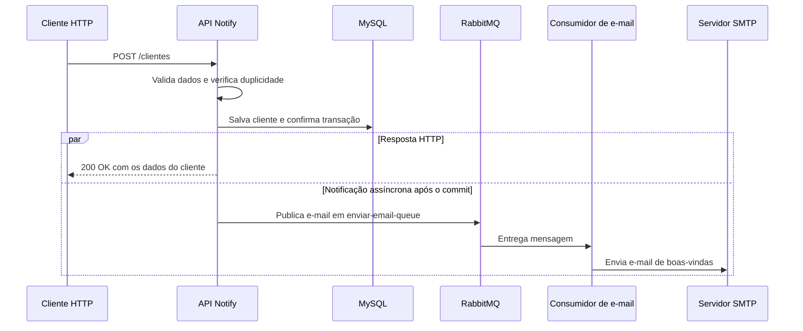

<div align="center">

# Notify

### Cadastro via REST. Notificações por eventos.

API que integra cadastro de clientes, persistência em MySQL e envio assíncrono de e-mails com RabbitMQ.


</div>

## Sobre o projeto

O **Notify** demonstra como conectar uma API REST a um fluxo de mensageria: ao cadastrar um cliente, a aplicação salva os dados no banco e, após a confirmação da transação, publica o endereço de e-mail em uma fila do RabbitMQ. Um consumidor processa a mensagem e envia um e-mail de boas-vindas via SMTP.

O envio do e-mail ocorre fora do processamento da requisição HTTP, separando o cadastro da comunicação com o servidor de e-mail.

## Funcionalidades

- **Cadastro de clientes:** endpoint REST para registrar nome e e-mail.
- **Validação de entrada:** nome e e-mail não podem ser nulos, vazios ou conter apenas espaços.
- **Controle de duplicidade:** verificação de e-mail já cadastrado e restrição de unicidade no banco.
- **Persistência em MySQL:** armazenamento com Spring Data JPA.
- **Publicação após o commit:** o evento de cadastro só é encaminhado ao RabbitMQ após a confirmação da transação.
- **Notificação assíncrona:** consumo da fila e envio de e-mail de confirmação via SMTP.
- **Infraestrutura local:** RabbitMQ e MySQL definidos no Docker Compose.

## Como funciona



> A resposta HTTP confirma o cadastro, não a entrega do e-mail. O fluxo de notificação é processado de forma assíncrona.

## Tecnologias utilizadas

| Tecnologia | Papel no projeto |
| --- | --- |
| **Java 25** | Linguagem principal, com records para DTOs |
| **Spring Boot 4.1.2** | Configuração e execução da aplicação |
| **Spring Web MVC** | Exposição do endpoint REST |
| **Jakarta Bean Validation** | Validação dos dados recebidos |
| **Spring Data JPA / Hibernate** | Mapeamento e persistência das entidades |
| **MySQL** | Banco de dados relacional |
| **Spring AMQP / RabbitMQ** | Publicação e consumo de mensagens |
| **Spring Mail** | Envio de e-mails via SMTP |
| **Lombok** | Redução de código repetitivo |
| **Docker Compose** | Provisionamento da infraestrutura local |
| **Maven Wrapper** | Build e execução sem instalação global do Maven |

## Decisões de arquitetura

**Separação de responsabilidades:** controller, service, repository, DTOs e entidade organizam o fluxo de cadastro. Os componentes de mensageria e e-mail ficam separados da lógica de persistência.

**Consistência com a transação:** o uso de `@TransactionalEventListener(AFTER_COMMIT)` evita publicar o evento de um cadastro cuja transação tenha sido revertida.

**Processamento assíncrono:** `@Async` e `@RabbitListener` desacoplam a publicação e o envio do e-mail do atendimento HTTP.

**Fila durável:** a fila `enviar-email-queue` é declarada como durável. Isso, isoladamente, não representa garantia de entrega ponta a ponta.

## Executando localmente

### Pré-requisitos

- JDK 25.
- Docker com Docker Compose.
- Credenciais de um servidor SMTP — como o Mailtrap Sandbox, usado na configuração atual.

### 1. Clone o repositório

```powershell
git clone https://github.com/FelipePFreitas/Notify.git
cd Notify
```

### 2. Configure o SMTP

Defina as variáveis de ambiente na mesma sessão do PowerShell em que executará a aplicação:

```powershell
$env:SPRING_MAIL_HOST = "sandbox.smtp.mailtrap.io"
$env:SPRING_MAIL_PORT = "587"
$env:SPRING_MAIL_USERNAME = "<seu-usuario-smtp>"
$env:SPRING_MAIL_PASSWORD = "<sua-senha-smtp>"
```

As variáveis sobrescrevem as propriedades correspondentes de `application.properties`. Não versione credenciais reais.

> O Mailtrap Sandbox captura mensagens para inspeção em desenvolvimento; ele não entrega e-mails às caixas de entrada dos destinatários.

### 3. Inicie a infraestrutura

```powershell
docker compose up -d
```

| Serviço | Endereço local |
| --- | --- |
| MySQL | `localhost:3307`, banco `notify` |
| RabbitMQ — AMQP | `localhost:5672` |
| Painel do RabbitMQ | http://localhost:15672 |

O painel do RabbitMQ usa `guest` / `guest` na configuração de desenvolvimento. As credenciais do Compose são exclusivamente para uso local.

### 4. Inicie a API

```powershell
.\mvnw.cmd spring-boot:run
```

A API estará disponível em **http://localhost:8080**. O Hibernate está configurado com `ddl-auto=update` para atualizar o esquema durante o desenvolvimento.

## Utilizando a API

### Cadastrar cliente

**`POST /clientes`**

```http
POST /clientes HTTP/1.1
Host: localhost:8080
Content-Type: application/json

{
  "nome": "Ana Silva",
  "email": "ana@example.com"
}
```

**Resposta de sucesso — `200 OK`:**

```json
{
  "id": 1,
  "nome": "Ana Silva",
  "email": "ana@example.com"
}
```

O identificador é gerado pelo banco. Após o cadastro, o endereço de e-mail segue para a fila de notificações.

### Exemplo no PowerShell

```powershell
$body = @{
    nome = "Ana Silva"
    email = "ana@example.com"
} | ConvertTo-Json

Invoke-RestMethod `
    -Uri "http://localhost:8080/clientes" `
    -Method Post `
    -ContentType "application/json" `
    -Body $body
```

## Estrutura do projeto

```text
src\main\java\com\felipefreitas\notify\
├── controller\    # Endpoint REST de cadastro
├── dto\           # Dados de entrada, resposta e evento
├── entity\        # Entidade Cliente
├── repository\    # Acesso ao banco de dados
├── service\       # Regras de cadastro e publicação do evento
├── RabbitMQ\      # Configuração da fila e publicação de mensagens
└── mail\          # Consumo da fila e envio via SMTP
```

## Escopo atual e possíveis evoluções

O projeto implementa o fluxo de **cadastro e e-mail de boas-vindas**. Não inclui endpoints de consulta, atualização ou exclusão, autenticação, validação do formato de e-mail nem tratamento HTTP específico para e-mail duplicado.

A publicação após o commit não elimina a possibilidade de falha entre o banco e o broker. Mecanismos como **Transactional Outbox**, política explícita de retentativas e **Dead Letter Queue** são possíveis evoluções, ainda não implementadas.

---

Desenvolvido por [Felipe Freitas](https://github.com/FelipePFreitas).
